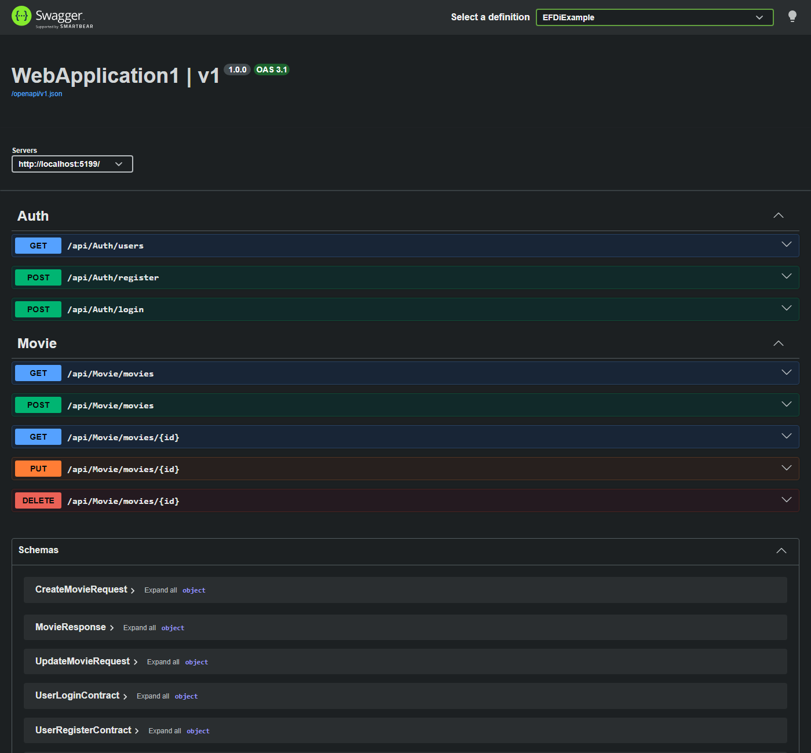

# Movie API: контракти та валідація

ASP.NET Core Web API (.NET 10): Controller -> Service -> Repository -> DbContext -> SQL Server LocalDB.

## Інструкція запуску

1. Потрібні .NET 10 SDK і SQL Server LocalDB (входить у Visual Studio).
2. Рядок підключення в `WebApplication1/appsettings.json` (ключ `ConnectionStrings:DefaultConnection`).
3. Застосувати міграції:
   ```
   cd WebApplication1
   dotnet ef database update
   ```
   (або `update-database` у Package Manager Console)
4. Запустити: `dotnet run --launch-profile http` і відкрити `http://localhost:5199/swagger`.

## Ендпоінти фільмів (`api/Movie`)

| Метод | Маршрут | Тіло | Відповідь |
|---|---|---|---|
| GET | `/movies` | - | 200 `MovieResponse[]` |
| GET | `/movies/{id}` | - | 200 `MovieResponse` / 404 |
| POST | `/movies` | `CreateMovieRequest` | 201 `MovieResponse` / 400 |
| PUT | `/movies/{id}` | `UpdateMovieRequest` | 200 `MovieResponse` / 400 / 404 |
| DELETE | `/movies/{id}` | - | 204 / 404 |

Id не входить у `CreateMovieRequest` (його генерує БД) і в `UpdateMovieRequest` (береться з маршруту). Поля фільму: `Title`, `Description`, `PhotoPath`, `Director`, `Runtime`, `ReleaseYear`, `PosterUrl`, `MovieUrl`.

## Ендпоінти коментарів (`api/Movie`)

| Метод | Маршрут | Тіло | Відповідь |
|---|---|---|---|
| GET | `/movies/{movieId}/comments` | - | 200 `MovieCommentResponse[]` / 404 |
| POST | `/movies/{movieId}/comments` | `CreateMovieCommentRequest` | 201 `MovieCommentResponse` / 400 / 404 |
| PUT | `/movies/{movieId}/comments/{id}` | `UpdateMovieCommentRequest` | 200 `MovieCommentResponse` / 400 / 404 |
| DELETE | `/movies/{movieId}/comments/{id}` | - | 204 / 404 |

`Id` і `CreatedAt` коментаря задає сервер. Коментар до неіснуючого фільму створити не можна (404). Видалення фільму видаляє і його коментарі (каскад).

Swagger UI з усіма ендпоінтами та схемами контрактів:



## 1. Data Annotations

| Атрибут | Призначення | Приклад |
|---|---|---|
| `[Required]` | значення обов'язкове (для рядка: не null і не порожній) | `[Required(ErrorMessage = "Title is required.")]` |
| `[StringLength(max, MinimumLength = min)]` | діапазон довжини рядка | `[StringLength(100, MinimumLength = 1)]` |
| `[MinLength(n)]` / `[MaxLength(n)]` | мінімальна / максимальна довжина рядка або колекції | `[MaxLength(1000)]` |
| `[Range(min, max)]` | діапазон числа | `[Range(1, 600)]` |
| `[EmailAddress]` | формат email | `[EmailAddress]` |
| `[Phone]` | формат телефону | `[Phone]` |
| `[Url]` | формат URL | `[Url]` |
| `[RegularExpression(pattern)]` | відповідність шаблону | `[RegularExpression(@"^\d{4}$")]` |
| `[Compare("Other")]` | збіг з іншою властивістю | `[Compare("Password")]` |
| `[CreditCard]` | формат номера картки | `[CreditCard]` |
| `[Key]` | первинний ключ (для EF, не валідація) | `[Key] public int Id` |

Пояснення атрибутів і типів контрактів:

- **Модель БД (Entity `Movie`)** описує таблицю, містить Id і всі поля, які зберігаються.
- **Контракт запиту** описує лише те, що клієнту дозволено надіслати, і містить правила перевірки.
- **Контракт відповіді (`MovieResponse`)** описує те, що сервер віддає клієнту (Id плюс потрібні поля, без службових даних).
- **Де перевіряти:** на межі системи, тобто в контролері до сервісу. Клієнту не можна довіряти: запит можуть надіслати зі зламаного клієнта чи зловмисно. З `[ApiController]` ASP.NET перевіряє атрибути сам і повертає 400.
- **Чому не давати клієнту задавати всі поля сутності (overposting):** клієнт зміг би підставити Id, службові поля або права (наприклад `IsAdmin`), перезаписати чужі записи. Окремий контракт відкриває тільки безпечні поля.

## 4. Результати перевірки (попередня версія без коментарів і нових полів)

Запити виконані на запущеному застосунку тими самими HTTP-викликами, що йдуть зі Swagger UI. Початковий стан БД: 7 фільмів. Після всіх помилкових запитів кількість і дані не змінились.

| # | Запит | Очікувано | Фактично |
|---|---|---|---|
| OK1 | POST `/movies` `{"title":"Inception","description":"Dream heist","photoPath":"http://x/y.jpg","director":"Nolan","runtime":148}` | 201, фільм з Id | 201, `{"id":22,...}` |
| OK2 | GET `/movies` | 200, список | 200, список з новим фільмом |
| OK3 | GET `/movies/22` | 200, фільм | 200, `{"id":22,"title":"Inception",...}` |
| OK4 | PUT `/movies/22` `{"title":"Inception 2",...,"runtime":150}` | 200, оновлений | 200, `title":"Inception 2","runtime":150` |
| OK5 | DELETE `/movies/22` | 204 | 204, у списку фільму більше немає |
| ERR1 | POST, `"title":""` | 400, помилка Title | 400, `Title: ["Title is required.","Title must be between 1 and 100 characters."]` |
| ERR2 | POST, title із 101 символу | 400, помилка Title | 400, `Title: ["Title must be between 1 and 100 characters."]` |
| ERR3 | POST, `"runtime":-5` | 400, помилка Runtime | 400, `Runtime: ["Runtime must be between 1 and 600 minutes."]` |
| ERR4 | POST, `"runtime":601` | 400, помилка Runtime | 400, `Runtime: ["Runtime must be between 1 and 600 minutes."]` |
| ERR5 | POST без `director` | 400, помилка Director | 400, `Director: ["Director is required."]` |
| ERR6 | GET `/movies/99999` | 404 | 404, `Movie with id 99999 not found.` |
| ERR7 | PUT `/movies/99999` з коректним тілом | 404 | 404, `Movie with id 99999 not found.` |
| ERR8 | PUT `/movies/22`, `"runtime":0` | 400, дані не змінились | 400, `Runtime: [...]`, запис не змінився |
| ERR9 | DELETE `/movies/99999` | 404 | 404, `Movie with id 99999 not found.` |

Після ERR1-ERR9 GET `/movies` показав ті самі дані, що й до них (некоректні дані не збереглись).

## 5. FluentValidation і Data Annotations

| | Data Annotations | FluentValidation |
|---|---|---|
| Де правила | атрибути на моделі | окремий клас-валідатор |
| Пакет | вбудований | NuGet |
| Виклик | автоматично з `[ApiController]` | вручну (`Validate`) |
| Складні умови (`When`, залежності між полями, сервіси) | обмежено | зручно |
| Модель | засмічена атрибутами | чиста |

Те саме правило «Title обов'язковий, до 100 символів»:

```csharp
// Data Annotations
[Required(ErrorMessage = "Title is required.")]
[MaxLength(100, ErrorMessage = "Title cannot exceed 100 characters.")]
public string Title { get; set; }

// FluentValidation
RuleFor(x => x.Title)
    .NotEmpty().WithMessage("Title is required.")
    .MaximumLength(100).WithMessage("Title cannot exceed 100 characters.");
```

Контракти фільмів і коментарів валідуються через FluentValidation (`Validations/`): `CreateMovieRequestValidator`, `UpdateMovieRequestValidator`, `CreateMovieCommentRequestValidator`, `UpdateMovieCommentRequestValidator`. Спільні правила винесені в базові класи `MovieRequestValidator<T>` і `MovieCommentRequestValidator<T>`. Data Annotations залишились лише на Entity-моделях (схема БД). Реєстрація та логін (User) також використовують FluentValidation.

## 6. Розширення: ReleaseYear, PosterUrl, MovieUrl, коментарі

Шари: Controller -> Service -> Repository (інтерфейси, реєстрація в DI в `Program.cs`) -> DbContext. Контролери не звертаються до `AppDbContext` напряму.

Правила валідації:
- `Title`, `Director` обов'язкові, до 100 символів; `Description` до 1000; `PhotoPath`, `PosterUrl`, `MovieUrl` до 500.
- `Runtime` від 1 до 600.
- `ReleaseYear` не раніше 1888 і не більше ніж поточний рік + 1.
- `PosterUrl` і `MovieUrl` необов'язкові, але якщо вказані, мають бути абсолютними `http` або `https` посиланнями.
- Коментар: `AuthorName` обов'язковий до 100 символів, `Text` обов'язковий до 1000 символів.

Міграція: `AddMovieExtensionsAndComments` (нові колонки `ReleaseYear`, `PosterUrl`, `MovieUrl`, таблиця `MovieComments` з FK і каскадним видаленням). Старі фільми отримали `ReleaseYear = 0`, його треба оновити через PUT.

Результати перевірки (Swagger-еквівалентні HTTP-запити на запущеному застосунку):

| # | Запит | Очікувано | Фактично |
|---|---|---|---|
| OK1 | POST `/movies` з усіма полями | 201 | 201, `{"id":23,...,"releaseYear":2014}` |
| OK2 | GET `/movies/23` | 200 | 200 |
| OK3 | PUT `/movies/23` з `runtime: 170` | 200 | 200, нові значення |
| OK4 | POST `/movies/23/comments` (два коментарі) | 201 | 201, `id` і `createdAt` від сервера |
| OK5 | GET `/movies/23/comments` | 200, список | 200, два коментарі |
| OK6 | PUT `/movies/23/comments/1` | 200 | 200, оновлений текст |
| OK7 | DELETE `/movies/23/comments/2` | 204 | 204 |
| ERR1 | POST, `"title":""` | 400 | 400, `Title: ["Title is required."]` |
| ERR2 | POST, `"releaseYear":2100` | 400 | 400, `ReleaseYear: ["Release year cannot be more than one year in the future."]` |
| ERR3 | POST, `"posterUrl":"ftp://x/y.jpg"` | 400 | 400, `PosterUrl: ["Poster URL must be a valid http or https link."]` |
| ERR4 | PUT, `"runtime":0` | 400, дані не змінились | 400, `Runtime: ["Runtime must be between 1 and 600 minutes."]` |
| ERR5 | POST коментаря до фільму 99999 | 404 | 404, `Movie with id 99999 not found.` |
| ERR6 | POST коментаря з порожнім `text` | 400 | 400, `Text: ["Comment text is required."]` |
| ERR7 | POST коментаря, `authorName` 101 символ | 400 | 400, `AuthorName: ["Author name cannot exceed 100 characters."]` |
| ERR8 | PUT коментаря через неіснуючий фільм | 404 | 404, `Comment with id 1 not found for movie 99999.` |
| ERR9 | GET коментарів неіснуючого фільму | 404 | 404 |
| ERR10 | DELETE фільму 99999 | 404 | 404 |
| OK8 | DELETE фільму 23, далі GET його коментарів | 204, 404 | 204, 404 (коментарі видалені каскадно) |

## 7. Сеанси фільмів (`api/MovieSession`)

Модель `MovieSession`: `Id`, `MovieId` (зв'язок «один фільм — багато сеансів», FK з каскадним видаленням), `StartsAt`, `HallName`, `Price` (`decimal(10,2)`), `AvailableSeats`. Зв'язок налаштовано в `AppDbContext` через Fluent API. Міграція: `AddMovieSessions`.

Часовий пояс: **усі часи сеансів у UTC**. API приймає `StartsAt` лише з суфіксом `Z` (наприклад `2030-01-15T18:00:00Z`); зсув на кшталт `+02:00` відхиляється. Відповідь завжди містить `Z`. В інтерфейсі час підписано як UTC.

| Метод | Маршрут | Тіло | Відповідь |
|---|---|---|---|
| GET | `/MovieSession/sessions?movieId=&date=&maxPrice=` | - | 200 `MovieSessionResponse[]` / 400 |
| GET | `/MovieSession/sessions/{id}` | - | 200 `MovieSessionResponse` / 404 |
| POST | `/MovieSession/sessions` | `CreateMovieSessionRequest` | 201 `MovieSessionResponse` / 400 |
| PUT | `/MovieSession/sessions/{id}` | `UpdateMovieSessionRequest` | 200 `MovieSessionResponse` / 400 / 404 |
| DELETE | `/MovieSession/sessions/{id}` | - | 204 / 404 |

- GET повертає лише **майбутні** сеанси, відсортовані від найближчого. `date` (`yyyy-MM-dd`, UTC-день) і `maxPrice` є необов'язковими фільтрами.
- `MovieSessionResponse` містить `MovieTitle` (назву фільму), щоб клієнту не потрібен другий запит.
- Правила: фільм має існувати (`MovieId`), `HallName` обов'язкова до 50 символів, `Price` і `AvailableSeats` не від'ємні, `Price` не більше 99999999.99. Створити сеанс у минулому не можна. При редагуванні перевіряється час лише тоді, коли він змінився.
- Видалення фільму з майбутніми сеансами повертає 409 і не видаляє дані. Видалення фільму без майбутніх сеансів каскадно видаляє його минулі сеанси та коментарі.

DTO розділені: `CreateMovieSessionRequest`, `UpdateMovieSessionRequest` і `MovieSessionResponse`. Валідація: `MovieSessionRequestValidator<T>` (спільні правила), `CreateMovieSessionRequestValidator` (додає правило «не в минулому»).

Асинхронність: контролер, сервіс і репозиторій для фільмів, коментарів і сеансів повертають `Task`/`Task<T>` і використовують `ToListAsync`, `FirstOrDefaultAsync`, `AnyAsync`. `SaveChangesAsync` винесено в окремий метод репозиторію, який сервіс викликає після змін. Авторизація (`AuthController`, `UserService`) поки синхронна і не входить до цього етапу.

## 8. Запуск клієнта

```
cd client
npm ci
npm run dev
```

Відкрити `http://localhost:5173`. Сторінки (хеш-маршрути):
- `#/afisha`: афіша майбутніх сеансів з фільтрами за датою та максимальною ціною, сортування від найближчого.
- `#/movies`: список фільмів, додавання і видалення. Назва фільму відкриває `#/movies/{id}`.
- `#/movies/{id}`: інформація про фільм і його майбутні сеанси.
- `#/admin`: панель керування сеансами (створення, редагування, видалення). Фільм обирається зі списку, який віддає API.

Приховування кнопок не є захистом API. Рольовий доступ і JWT не реалізовані.
